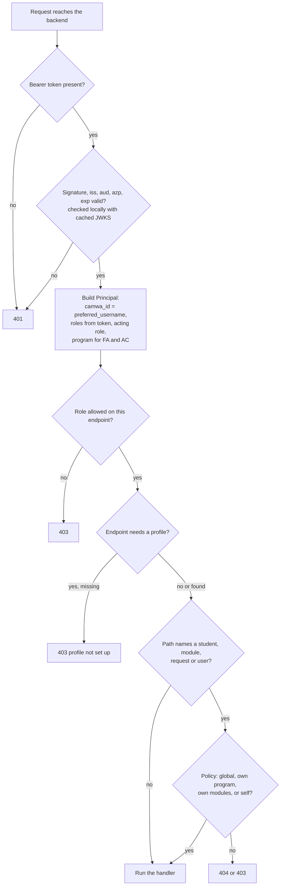
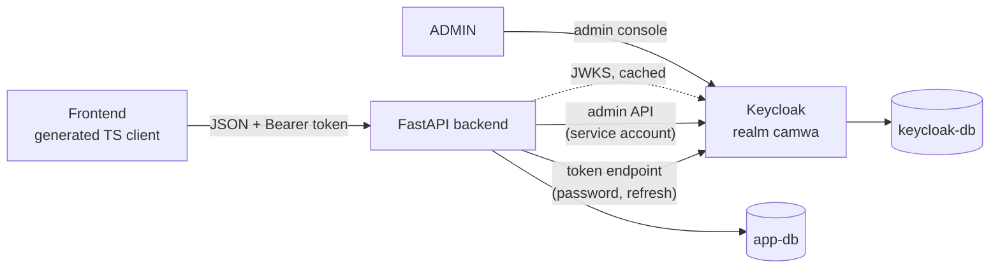
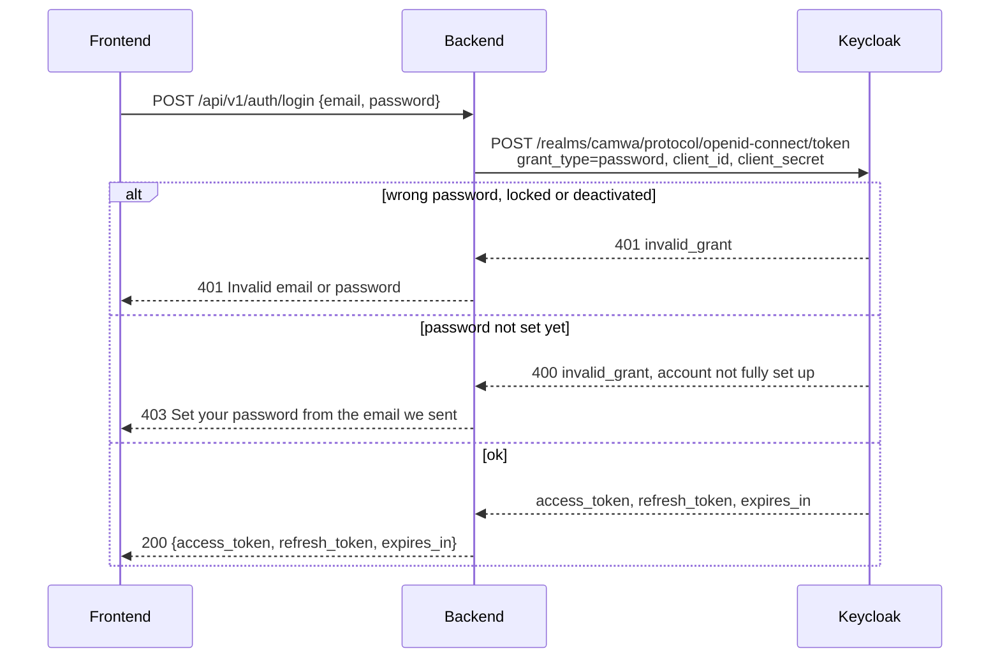
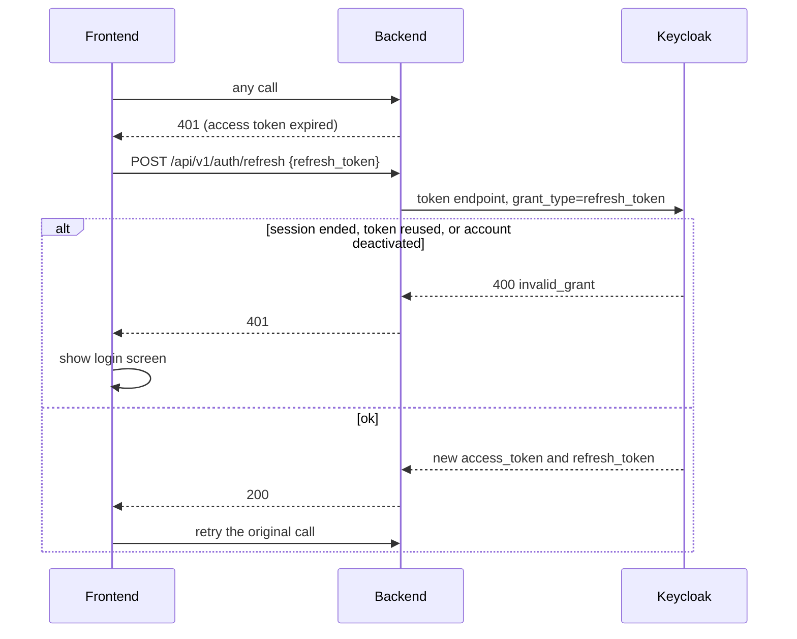
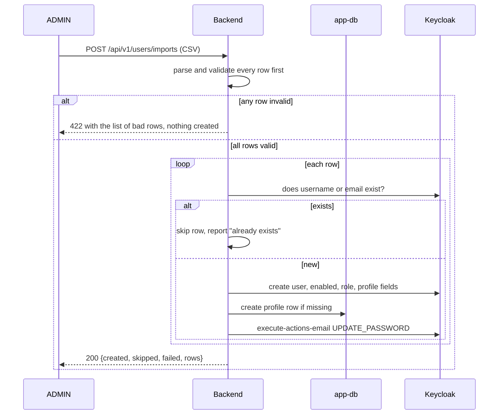
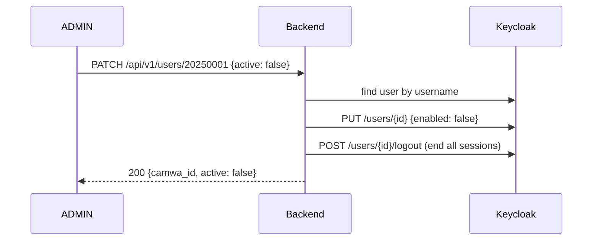

# Keycloak authentication and authorization

Status: backend implemented on branch `firebase-auth`, tested against a fake Keycloak only. Replaces the Firebase identity provider. [Implementation notes](#implementation-notes) lists where the code differs from this design.

## Decisions

| Topic | Decision |
|---|---|
| API style | REST under `/api/v1`. Every current endpoint is renamed. See [REST conventions](#rest-conventions). |
| Identity provider | Keycloak, realm `camwa`. The Firebase provider is deleted. |
| User store | Keycloak is the only user store. The app's `iam` table and `/api/account/*` endpoints are deleted. |
| User id | The Keycloak username is the CAMWA id, a number such as a student id. The app uses it everywhere it used `iam_id`. |
| Creating accounts | ADMIN creates one account at a time in the Keycloak admin console, or many at once with a CSV file through `POST /api/v1/users/imports`. |
| Deactivating accounts | Soft delete with Keycloak's built-in `enabled` flag, through `PATCH /api/v1/users/{camwa_id}` with `{"active": false}`. The app never hard-deletes users. ADMIN can still delete a user in the Keycloak console. |
| Who talks to Keycloak | Only the backend. The frontend never calls Keycloak and never sees its URL. |
| Sign-in | Email and password through `POST /api/v1/auth/login`. The backend exchanges them with Keycloak and returns Keycloak's JWTs. Phone OTP sign-in is dropped. |
| Token checks | Every API call carries `Authorization: Bearer <access token>`. The backend verifies it locally with Keycloak's cached public keys. |
| Not signed in | The API answers `401`. The frontend shows its login screen. The API never answers `302`. |
| Roles | Realm roles `ADMIN`, `FA`, `LECTURER`, `AC`, `STUDENT`, the same strings as `AccountRole`. |
| ADMIN reach | Global. |
| FA reach | Limited to the program in `facility_faculty.program_id`. FA manages profiles, not logins. |
| AC reach | Limited to the program in `academic_coordinator.program_id`, the same rule as FA. |
| Account status in lists | Not shown. Student and lecturer lists come from the app only. |
| Attendance corrections | Only ADMIN and FA approve or reject them. FA only within their program. |
| Databases | `keycloak-db` belongs to Keycloak. `app-db` stays CAMWA's. Neither service reads the other's database. |

## What each side owns

| Keycloak owns | The app owns |
|---|---|
| Accounts: CAMWA id, email, name, phone | Profiles: the `student`, `lecturer`, `academic_coordinator` and `facility_faculty` rows |
| Passwords, reset emails, lockouts | Programs, intakes, semesters, modules |
| Roles | Registrations, attendance, requests, exams, notifications, images |
| Active or deactivated (`enabled`) | The AC hat (`academic_coordinator.current_role`) |
| Sessions and tokens | Program membership, which FA and AC scoping reads |

The two sides link by one value. The Keycloak username equals the profile's id (`student_id`, `lecturer_id`, `ac_id`, `staff_id`). No foreign key can cross the two databases, so the backend handles the gaps on purpose:

| Case | What happens |
|---|---|
| Account exists, profile doesn't yet | Sign-in and `/api/v1/me` work. Endpoints that need the profile answer `403 Your CAMWA profile is not set up yet. Ask your faculty office.` |
| Profile exists, account doesn't yet | Normal. A student can be added to the app before their account exists. They link the first time they sign in. |
| Account deactivated | Sign-in and refresh fail. Profile and records stay. |
| Account hard-deleted in the Keycloak console | The same as deactivated for the app. Records stay as history. `scripts/reconcile_users.py` lists profiles with no account and accounts with no profile. |

## Why 401 and not a 302 redirect

The backend is a JSON API that the frontend calls with `fetch`. A `302` doesn't work there:

- `fetch` follows a redirect silently. The frontend would get the HTML of a login page with status `200`, instead of JSON.
- The browser blocks the cross-origin redirect to the login page under CORS, so the frontend sees only a network error.
- With password sign-in there is no Keycloak login page to send anyone to. The login form belongs to the frontend.

A `302` to a login page fits a server-rendered site that keeps a session cookie. CAMWA is an API, so it signals with status codes and the frontend decides what to show.

| Status | Meaning | Frontend reaction |
|---|---|---|
| `401` + `WWW-Authenticate: Bearer` | No token, a bad signature, or an expired token. | Call `/api/v1/auth/refresh` once. If that fails too, show the login screen. |
| `403` | The token is valid, but this role or this user may not do this. | Show "You don't have access". |
| `404` | The row doesn't exist, or it belongs to someone you may not see. | Show "Not found". Owner checks return 404 so callers can't probe which ids exist. |

## Request flow



Checking the token needs no network call. The backend calls Keycloak only for sign-in, refresh, sign-out, password actions, the CSV import, deactivation, and looking up a student's email.

## Architecture



## Realm `camwa`

The realm lives in `keycloak/realm-camwa.json`. Keycloak imports it at startup with `--import-realm`. Secrets come in as `${ENV}` placeholders, so the file holds no credentials and is committed.

| Setting | Value | Reason |
|---|---|---|
| Realm roles | `ADMIN`, `FA`, `LECTURER`, `AC`, `STUDENT` | `AC` is a composite that includes `LECTURER`. |
| Default roles | none of the five | A user with no CAMWA role gets 403 everywhere. |
| User registration | off | Only ADMIN creates accounts. |
| Login with email | on, duplicate emails off | Users sign in with their email. |
| Edit username | off | The username is the CAMWA id and never changes. |
| Delete account action | off | Users can't delete themselves. |
| Brute force detection | on | Replaces the old `failed_attempts` and `locked_until` columns. It also covers the password grant. |
| Password policy | `length(12) and notEmail and passwordHistory(3)` | A starting point to tune. |
| SMTP | from the existing `MAIL_*` settings | Keycloak sends the set-password and reset-password emails. |
| Access token lifespan | 5 minutes | Caps how long a role change or deactivation takes to apply. |
| SSO session idle / max | 30 minutes / 10 hours | Refresh tokens stop working after these. |
| Revoke refresh token | on, reuse 0 | Each refresh token works once. A stolen one that's replayed fails. |

### User profile

Keycloak's declarative user profile defines the fields an account has. Users can view these fields but only ADMIN edits them.

| Field | Kind | Rules | In the token as |
|---|---|---|---|
| `username` | built-in | Required. The CAMWA id. Validator pattern `^[0-9]{1,20}$`. Unique, which Keycloak enforces for usernames. | `preferred_username` |
| `email` | built-in | Required, unique. | `email` |
| `firstName`, `lastName` | built-in | Required. | `given_name`, `family_name` |
| `phone_number` | custom attribute | Optional. Validator pattern `^\+[1-9][0-9]{6,14}$` (E.164). | `phone_number` |

`phone_number` is the only custom field. The CAMWA id goes in the username, not a custom attribute, because Keycloak enforces uniqueness only on built-in fields. Program stays in the app's profile rows so it has one owner.

### Client `camwa-backend`

One confidential client. Its secret is `KEYCLOAK_CLIENT_SECRET` and never leaves the backend.

| Setting | Value |
|---|---|
| Client authentication | on (confidential) |
| Standard flow, implicit flow | off |
| Direct access grants | on. This is the password grant behind `/api/v1/auth/login`. |
| Service account | on, with `realm-management` roles `manage-users`, `view-users` and `query-users` |
| Audience mapper | adds `camwa-backend` to the access token's `aud` |
| Client scopes | `roles`, `email`, `profile`, plus a `phone` scope that maps the `phone_number` attribute |

The Keycloak bootstrap admin (`KC_BOOTSTRAP_ADMIN_*`) belongs to the `master` realm. It opens the Keycloak console only. CAMWA admins get a `camwa` realm account with the `ADMIN` role plus the `realm-management` roles `manage-users` and `view-users`, so they can use the console for that realm without master-realm access.

## Token claims the backend reads

| Claim | Used as |
|---|---|
| `preferred_username` | `Principal.camwa_id`, the key into every app table. |
| `realm_access.roles` | `Principal.roles`. Roles outside the five are ignored. |
| `email`, `given_name`, `family_name`, `phone_number` | Returned by `/api/v1/me`. Never stored. |
| `iss` | Must equal `{KEYCLOAK_URL}/realms/camwa`. |
| `aud`, `azp` | `aud` contains `camwa-backend`, and `azp` equals `camwa-backend`. |
| `exp` | Must be in the future. |

## Roles

Each user has exactly one CAMWA role. The CSV import enforces that. A user given two unrelated roles in the console, such as `ADMIN` and `STUDENT`, gets 403.

| Role | Who | What they can do | Reach |
|---|---|---|---|
| `ADMIN` | System administrator | Everything. The only role that manages accounts (console, CSV import, deactivate), intakes, semesters, programs, facility faculty, camera paths, module deletion and the dashboard. | Global |
| `FA` | Facility faculty staff | Runs their program. Creates and edits student and lecturer profiles, modules and registrations. Records and edits attendance. Approves corrections. Runs exam eligibility. | Own program |
| `LECTURER` | Teaching staff | Sees and records attendance for the modules they teach and the students registered in them. Updates and exports exam eligibility for their own modules. | Own modules |
| `AC` | Academic coordinator, also a lecturer | Everything a lecturer can do. While acting as AC, also reads students, lecturer workloads and exam eligibility across their program. | Own modules as LECTURER, own program as AC |
| `STUDENT` | Enrolled student | Sees their own profile, modules, attendance, exam eligibility, images and notifications. Submits their own attendance and correction requests. Withdraws a request while it's pending. | Self |

### Acting role

- For most users the acting role is their one CAMWA role.
- An AC's token holds `AC` and `LECTURER`, because `AC` is a composite. The backend reads `academic_coordinator.current_role` to pick the acting role. `PUT /api/v1/me/acting-role` sets it, and the change applies on the next request with no new token.

## Scopes

Every endpoint uses one or more of these scopes. Each scope is one function in `backend/core/policies.py`.

| Scope | Rule | How the backend finds the program or owner |
|---|---|---|
| Global | No row check. ADMIN only, plus read-only reference data for everyone. | none |
| Own program | The row's program equals the FA's or AC's program. | Student: `student.program_id`. Module: `module.program_id`. Registration, attendance, request, exam: through their `module_id`. Lecturer: `lecturer.program_id`. |
| Own modules | `module.lecturer_id` equals the lecturer's CAMWA id. | Registration, attendance, request: through their `module_id`. A student is "own" when registered in one of the lecturer's modules. |
| Self | The row belongs to the caller. | `student_id`, `lecturer_id` or `receiver_id` equals the caller's CAMWA id. |

Rules that follow from these scopes:

- A student whose `program_id` is null is visible only to ADMIN until an FA or ADMIN assigns a program.
- An FA can't move a student, lecturer or module out of their program or into another one.
- New correction requests notify the shared receiver `FACULTY`. An FA sees a `FACULTY` notification only when its request's module is in their program.
- Bulk profile imports by FA reject any row outside their program, and the whole file fails with the list of bad rows.

## Code shape

```python
# backend/core/deps.py
@dataclass(frozen=True)
class Principal:
    camwa_id: str                   # preferred_username
    roles: frozenset[AccountRole]   # from the verified token
    acting: AccountRole             # AC resolved through academic_coordinator.current_role
    program_id: str | None          # set for FA and AC, None for everyone else

async def get_principal(token = Depends(bearer), db: AsyncSessionDep) -> Principal: ...

def require_role(*allowed: AccountRole): ...   # same aliases as today: AdminOnly, AdminOrFA, ...
```

```python
# backend/core/policies.py
async def ensure_student_access(p: Principal, student_id: str, db) -> None:
    """ADMIN all. FA, AC own program. LECTURER students in own modules. STUDENT self."""

async def ensure_module_access(p: Principal, module_id: str, db) -> None:
    """ADMIN all. FA, AC own program. LECTURER own modules."""

def scope_query(p: Principal, stmt: Select, module_col) -> Select:
    """Adds the program or own-modules filter to list endpoints."""
```

```python
# a controller
@router.get("/module/{module_id}")
async def get_by_module(module_id: str, db: AsyncSessionDep, p: AdminOrFAOrLecturer):
    await ensure_module_access(p, module_id, db)
    return await module_registration_service.get_by_module(db, module_id)
```

Two tests keep this honest:

1. A route coverage test walks every route in the app. It fails if a route has no role dependency, unless the route is on a short public list: `/api/v1`, the docs, `/api/v1/auth/login`, `/api/v1/auth/refresh` and `/api/v1/auth/password-reset`.
2. A matrix test calls each endpoint once per role and scope case. It asserts the status codes in the endpoint matrix below.

## Flows

### Sign in



The backend returns one message for a wrong password, a locked account and a deactivated account, so the response doesn't reveal which accounts exist.

### Call an API

The frontend sets `Authorization: Bearer <access_token>` with one request interceptor in the generated client. The backend runs the request flow above.

### Refresh



### Sign out

`POST /api/v1/auth/logout` with the refresh token. The backend calls Keycloak's `/protocol/openid-connect/logout`, which ends that session. The access token stops working within 5 minutes. The frontend drops both tokens right away.

### Forgot password

`POST /api/v1/auth/password-reset {email}`. The backend finds the Keycloak user by email and calls `PUT /admin/realms/camwa/users/{id}/execute-actions-email` with `["UPDATE_PASSWORD"]`. Keycloak emails a link to its own reset page. The backend always answers `202`, whether or not the email exists.

### Change password

`PUT /api/v1/me/password {current_password, new_password}`, signed-in user only.

1. The backend checks `current_password` with a password grant.
2. It sets the new password with `PUT /admin/realms/camwa/users/{id}/reset-password`.
3. It ends the user's other sessions with `POST /admin/realms/camwa/users/{id}/logout`.

### Add one account (Keycloak console)

1. ADMIN opens the `camwa` realm in the Keycloak console and adds a user. The username is the CAMWA id. Email, first name, last name and phone go in the profile fields.
2. ADMIN assigns one realm role.
3. ADMIN sends the user a set-password email with **Credentials > Credential reset > Update Password**. The user can't sign in until they set it.
4. An FA or ADMIN creates the profile in the app, for example `POST /api/v1/students` with the same id, program and intake. This can also happen before step 1.

### Add many accounts (CSV import)

`POST /api/v1/users/imports`, ADMIN only, `multipart/form-data` with one `.csv` file, at most 2,000 rows.

```csv
camwa_id,email,first_name,last_name,role,program_id,intake,phone_number
20250001,an.nguyen@example.edu,An,Nguyen,STUDENT,SE,2025,+84901234567
20250002,binh.tran@example.edu,Binh,Tran,STUDENT,SE,2025,
10001,hoa.le@example.edu,Hoa,Le,LECTURER,SE,,
```

| Column | Required | Rule |
|---|---|---|
| `camwa_id` | yes | Digits only, 1 to 20. Becomes the Keycloak username and the profile id. |
| `email` | yes | Unique in the realm. |
| `first_name`, `last_name` | yes | |
| `role` | yes | One of `FA`, `LECTURER`, `AC`, `STUDENT`. `ADMIN` accounts are made only in the console. |
| `program_id` | yes | Must exist in the app. |
| `intake` | for `STUDENT` | Must exist in the app. |
| `phone_number` | no | E.164. |



- The import is safe to run again. Rows already in Keycloak are skipped, so a second run after a partial failure finishes the job without duplicates.
- Keycloak calls aren't transactional, so the result lists each row's outcome. A row whose profile insert fails after the Keycloak user was created is reported as `failed` with the reason. Re-running the file creates the missing profile.
- Nobody types or emails passwords. Each new user gets Keycloak's set-password email.
- The import replaces `POST /api/account/students/create-from-excel` and `POST /api/account/lecturers/create-from-excel`. The FA profile imports, now `POST /api/v1/students/imports` and `POST /api/v1/lecturers/imports`, stay. They create profiles only.

### Deactivate and reactivate

`PATCH /api/v1/users/{camwa_id}`, ADMIN only. The body `{"active": false}` deactivates and `{"active": true}` reactivates.



- The "active" field is Keycloak's built-in `enabled` flag. No custom field is needed, and the console and the API can't disagree.
- A deactivated user can't sign in or refresh. Their current access token stops working within 5 minutes.
- Profiles, attendance, exams and requests stay. Lists and reports still show the user's records.
- ADMIN can't deactivate their own account. That prevents locking out the last admin.
- The call is idempotent. Deactivating an inactive user returns 200 with no change.
- `GET /api/v1/users/{camwa_id}` returns one account's fields and `active`, for the deactivate screen. Lists don't show account status.
- Hard delete is available only in the Keycloak console. The app keeps the records.

### Set the AC hat

`PUT /api/v1/me/acting-role {"role": "AC"}` or `{"role": "LECTURER"}`, AC only. The backend saves it in `academic_coordinator.current_role` and returns it. No new token is needed. Setting the role the user already has changes nothing, which a toggle can't promise.

### Who am I

`GET /api/v1/me` returns the CAMWA id, email, name, phone number, roles, acting role, program, and whether a profile exists. It reads the token claims and the profile row, with no call to Keycloak. The frontend calls it after sign-in to choose which screens to show.

### Emailing a student

`_get_student_email` in `attendance_service.py` reads `iam.email` today. It changes to look up the user by username through the admin API. Correction emails are sent in a background task, so the extra call doesn't slow down the response.

## Data model changes

| Change | Detail |
|---|---|
| Drop table `iam` | Keycloak holds accounts. |
| `student.student_id` | Loses its foreign key to `iam.iam_id`. Stays the primary key and equals the Keycloak username. |
| `image_assets.iam_id` | Loses its foreign key and is renamed `camwa_id`. |
| `_ensure_student_refs_exist` | Stops checking for an `iam` row. A profile can exist before its account. |

`docs/migrations/003_keycloak_user_store.sql` makes these changes. Back up first, because dropping `iam` drops the emails and phone numbers it holds. `scripts/export_iam_csv.py` writes the current `iam` rows in the import CSV format, so existing users can be loaded into Keycloak with the import endpoint before the table is dropped.

## Seeding

- The realm import creates roles, the client, the user profile and settings.
- The realm import also creates the first CAMWA admin. Its username comes from `SEED_ADMIN_ID`, a CAMWA id. Its email is `SEED_ADMIN_EMAIL` and its password is `SEED_ADMIN_PASSWORD`, filled in from `${ENV}` placeholders when Keycloak imports the realm. Keycloak imports a realm only when it doesn't exist yet, so restarts change nothing.
- `python seed.py` creates only the app's reference data (intake, semester), as today.
- `SEED_DEMO_USERS=true` also seeds one FA, LECTURER, AC and STUDENT with profiles in one demo program for local testing. It refuses to run unless `KEYCLOAK_URL` points to localhost.

## Local setup

```yaml
# docker-compose.yml (pin exact image tags when implementing)
services:
  app-db:
    image: postgres:17
    environment: { POSTGRES_DB: camwa, POSTGRES_USER: camwa, POSTGRES_PASSWORD: "${APP_DB_PASSWORD}" }
    volumes: [app-db:/var/lib/postgresql/data]
    ports: ["5432:5432"]
  keycloak-db:
    image: postgres:17
    environment: { POSTGRES_DB: keycloak, POSTGRES_USER: keycloak, POSTGRES_PASSWORD: "${KC_DB_PASSWORD}" }
    volumes: [keycloak-db:/var/lib/postgresql/data]
  keycloak:
    image: quay.io/keycloak/keycloak:26.x
    command: start-dev --import-realm
    environment:
      KC_DB: postgres
      KC_DB_URL: jdbc:postgresql://keycloak-db:5432/keycloak
      KC_DB_USERNAME: keycloak
      KC_DB_PASSWORD: "${KC_DB_PASSWORD}"
      KC_BOOTSTRAP_ADMIN_USERNAME: "${KC_BOOTSTRAP_ADMIN_USERNAME}"
      KC_BOOTSTRAP_ADMIN_PASSWORD: "${KC_BOOTSTRAP_ADMIN_PASSWORD}"
      KEYCLOAK_CLIENT_SECRET: "${KEYCLOAK_CLIENT_SECRET}"
      SEED_ADMIN_ID: "${SEED_ADMIN_ID}"
      SEED_ADMIN_EMAIL: "${SEED_ADMIN_EMAIL}"
      SEED_ADMIN_PASSWORD: "${SEED_ADMIN_PASSWORD}"
    volumes: ["./keycloak:/opt/keycloak/data/import:ro"]
    ports: ["8080:8080"]
    depends_on: [keycloak-db]
volumes: { app-db: {}, keycloak-db: {} }
```

New backend settings in `.env.example`:

```dotenv
AUTH_PROVIDER=keycloak
KEYCLOAK_URL=http://localhost:8080
KEYCLOAK_REALM=camwa
KEYCLOAK_CLIENT_ID=camwa-backend
KEYCLOAK_CLIENT_SECRET=
```

The app's own `JWT_*` secrets and the `FIREBASE_*` settings are removed.

## Code changes

| Area | Change |
|---|---|
| `backend/core/identity/keycloak.py` | New `KeycloakIdentityProvider`. Password and refresh grants, logout, JWKS verification, and admin API calls for import, activation, password actions and email lookup. |
| `backend/core/identity/firebase.py` | Deleted, with `firebase-admin` in requirements. `PyJWT` stays for JWKS verification. |
| `backend/core/identity/base.py` | The protocol becomes what the app needs from a user store: `login`, `refresh`, `logout`, `verify_token`, `send_password_reset`, `change_password`, `create_user`, `set_enabled`, `get_user`, `find_user`. |
| `backend/core/security.py` | App JWT issuing and checking deleted. |
| `backend/core/deps.py` | `get_principal` and `Principal` replace the current user lookup. The role aliases stay. |
| `backend/core/policies.py` | New. The four scopes above. |
| `backend/controllers/account.py`, `backend/services/account_service.py` | Deleted. |
| `main.py` | Mounts every router under `/api/v1`. |
| `backend/controllers/users.py` | New. Import, get, and `active` updates. |
| `backend/controllers/me.py` | New. Every `/me` endpoint, gathered from the student, module registration, notification and account controllers. |
| `backend/controllers/auth.py` | `token-login` removed. Login, refresh, logout and password reset only. |
| `backend/models/iam.py` | Deleted. |
| `backend/controllers/*` | New paths and methods. Each endpoint gets the roles and policy call in the matrix. The `_ensure_*_self_access` helpers move into policies. |
| `backend/helpers/response_wrapper.py` | `ApiResponse` deleted. A generic `Page[T]` with `items` and `total` added. |
| `scripts/link_identities.py` | Deleted. `scripts/reconcile_users.py` and `scripts/export_iam_csv.py` added. |
| `frontend/src/generated` | Regenerated. |

## Implementation notes

Where the code differs from the sections above, the code wins.

- **One Keycloak client.** `backend/core/keycloak.py` holds `KeycloakClient` and its `keycloak` singleton. There is no provider protocol and no `AUTH_PROVIDER` setting, because only one provider exists. Tests swap its HTTP transport.
- **Paging.** `Page[T]`, `PageDep` and `paginate` live in `backend/helpers/pagination.py`. `backend/helpers/response_wrapper.py` is deleted.
- **Password reset** returns `202` and calls Keycloak in a background task, so response time doesn't show whether the email has an account.
- **Change password** returns `200` with a new token set, because ending the other sessions also ends the caller's refresh token. A wrong current password returns `403`, not `401`, so the frontend doesn't treat it as an expired session.
- **Missing profiles.** `get_principal` accepts a token whose account has no app profile, so `GET /me` can report `has_profile: false`. `require_role` rejects FA and AC callers that have no program. `/me` and `/me/acting-role` take `CurrentUser` and skip that check.
- **CSV import limits.** A file over 2,000 rows returns `413`. A missing column, an empty file or a non-UTF-8 file returns `400`. An `AC` row creates a `lecturer` row as well as the `academic_coordinator` row, because `module.lecturer_id` points at `lecturer`.
- **Deactivating yourself** returns `409`.
- **Attendance requests.** A second pending request for the same attendance row returns `409`. A decision takes `processed_by` from the token, not the body.
- **Exam eligibility export** computes rates when it runs and stores nothing.
- **FACULTY notifications are shared rows.** When one FA marks a faculty notification read or deletes it, every FA in that program sees the change.
- **Lazy routers.** FastAPI 0.162 mounts included routers lazily, so `app.routes` lists only one route per router. `tests/test_route_coverage.py` walks each controller's `router.routes` instead.

### Tests

`python -m pytest tests` runs against SQLite and `tests/fake_keycloak.py`. The fake signs RS256 tokens, serves JWKS, and answers the grants and admin calls the backend makes. The tests cover:

- token checks for signature, expiry, issuer, audience and `azp`
- login, single-use refresh, logout and password change
- role and program reach for programs, modules, attendance requests and notifications
- CSV import, deactivation, and a route coverage check that fails on any route without a principal

The realm import, SMTP and the Keycloak admin API's real responses have not been tested against a running Keycloak.

## Delivery order

Each step ends in a passing check and can ship on its own.

1. **Close the holes on the current auth.** Lock the public endpoints. Stop FA from managing ADMIN accounts. Add `policies.py` with own-modules and self scopes, and the route coverage test.
2. **REST paths.** Move every endpoint to its path in the matrix, drop the `ApiResponse` wrapper, add paging, regenerate the TS client and update the frontend in the same pull request.
3. **Program scope for FA and AC.** Add `program_id` to the principal and the own-program scope. Add the matrix test.
4. **Keycloak running locally.** Commit `docker-compose.yml` and `keycloak/realm-camwa.json` with the user profile and seeded admin. Check that the realm imports and a password grant returns a token for the admin.
5. **Backend trusts Keycloak.** Add `KeycloakIdentityProvider`, switch `get_principal` to `preferred_username`, add `/me`, `/me/acting-role` and `/me/password`, and delete Firebase and the app JWT code.
6. **Keycloak as the user store.** Add the admin user endpoints and the CSV import. Export existing `iam` rows, import them, then run `003_keycloak_user_store.sql` and delete the account controller and `iam` model.
7. **Frontend sign-in.** Regenerate the TS client and add the bearer interceptor and the 401 refresh-then-login handling.

## REST conventions

The current paths mix verbs, singular and plural names, and one-off routes per caller. The new paths follow these rules. The endpoint matrix lists every current endpoint and its replacement.

| Rule | Today | New |
|---|---|---|
| One base path with a version. A breaking change gets `/api/v2`. | `/api` | `/api/v1` |
| Plural nouns in kebab-case. No verbs in paths. The method says the action. | `POST /student/create`, `GET /module/view`, `PUT /module/update/{id}` | `POST /students`, `GET /modules`, `PATCH /modules/{module_id}` |
| Filters are query parameters on the collection, not extra paths. | `/module-registrations/student/{id}`, `/program/{id}/students` | `/module-registrations?student_id=`, `/students?program_id=` |
| Nest a path only when the child belongs to the parent. | `/student/{id}/images/{image_id}/info` | `/students/{student_id}/images/{image_id}` |
| The caller's own data lives under `/me`. The id comes from the token, so there is no path id to check. | `/student/my/images`, `/module-registrations/my-modules`, `/notification/` | `/me/images`, `/me/modules`, `/me/notifications` |
| An operation that isn't create, read, update or delete becomes a resource you create. | `POST /attendance/create-from-excel`, `POST /module/delete-from-excel` | `POST /attendance/imports`, `POST /modules/bulk-deletions` |
| A state change is an update of a field. | `PUT /attendance/correction/{id}`, `PUT /notification/{id}/read` | `PATCH /attendance-requests/{request_id}` with `status`, `PATCH /me/notifications/{notification_id}` with `status` |
| One way to reach a resource. Assigning a student to a program is an update of the student. | `POST /program/{pid}/students/{sid}` and `PUT /student/{sid}` | `PATCH /students/{student_id}` |
| Files download as files. | `POST /attendance/exam-eligibility/export` saves on the server and returns the path | `GET /exam-eligibility/export` streams the `.xlsx` |

### Methods and status codes

| Method | Use | Success |
|---|---|---|
| `GET` | Read. Never changes data. | `200` |
| `POST` | Create in a collection, or start an import, recalculation or bulk deletion. | `201` with a `Location` header for a created resource. `200` with a per-row report for imports. |
| `PATCH` | Change some fields. Every current `*Update` schema already has only optional fields, so all current `PUT` updates become `PATCH`. | `200` with the updated resource |
| `PUT` | Replace a single value that has no id of its own: camera path, password, acting role. | `200`, or `204` for the password |
| `DELETE` | Delete. | `204` with no body |

Errors: `400` malformed request, `401` not signed in, `403` not allowed, `404` not found or outside the caller's reach, `409` conflict such as a duplicate id or a row still in use, `422` a field fails validation. Every error has FastAPI's shape, `{"detail": ...}`.

### Bodies

- Success responses return the resource itself. The `ApiResponse {message, meta_data}` wrapper goes away. The status code already says what happened, and the generated client then gets the real types.
- Lists return `{"items": [...], "total": 123}` and take `?limit=` (default 50, at most 500) and `?offset=`. Today every list returns every row.
- Field names stay snake_case, as today.
- Request bodies never carry the caller's id. The backend reads it from the token.

### Changing over

The frontend is the only client, and it uses the generated client. So the change is one cut-over with no aliases for the old paths: the backend moves to the new paths, the TS client is regenerated, and the frontend is updated in the same pull request. Operation ids follow the new paths, for example `students-list` and `students-update`.

## Endpoint matrix

Roles and reach use the scopes above. "Current" roles come from the route dependencies on branch `firebase-auth`.

Paths are relative to `/api/v1`. "Replaces" lists the current endpoints, without the `/api` prefix, with their current roles.

### Auth

| Method | Path | Roles | Reach | Replaces | Notes |
|---|---|---|---|---|---|
| POST | `/auth/login` | public | - | `POST /auth/login` (**public**) | Returns Keycloak tokens. |
| POST | `/auth/refresh` | public | needs a valid refresh token | `POST /auth/refresh-token` (**public**) |  |
| POST | `/auth/logout` | everyone | self | `POST /auth/logout` (any signed-in) | 204. |
| POST | `/auth/password-reset` | public | - | `POST /auth/forgot-password` (**public**) | 202 whether or not the email exists. |

### Me

| Method | Path | Roles | Reach | Replaces | Notes |
|---|---|---|---|---|---|
| GET | `/me` | everyone | self | new | Account fields from the token, plus roles, acting role, program and profile status. |
| PUT | `/me/password` | everyone | self | `PUT /account/{iam_id}/change-password` (any signed-in) | 204. |
| PUT | `/me/acting-role` | AC | self | new | Body `{"role": "LECTURER"}` or `{"role": "AC"}`. Replaces the commented-out toggle. |
| GET | `/me/registrations` | STUDENT | self | `GET /module-registrations/my-registrations` (STUDENT) |  |
| GET | `/me/attendance-summary` | STUDENT | self | `GET /student/my/modules-with-attendance` (STUDENT) |  |
| GET | `/me/exam-eligibility` | STUDENT | self | `GET /student/my/exam-eligibility-status` (STUDENT) |  |
| GET | `/me/images` | STUDENT | self | `GET /student/my/images` (STUDENT) |  |
| GET | `/me/modules` | LECTURER, AC | own modules | `GET /module-registrations/my-modules` (LECTURER) |  |
| GET | `/me/modules/attendance` | LECTURER, AC | own modules | `GET /module-registrations/my-modules/students-attendance` (LECTURER) |  |
| GET | `/me/notifications` | everyone | self | `GET /notification/` (ADMIN, FA, LECTURER, STUDENT, AC) | `?status=UNREAD`. FA also sees `FACULTY` notifications for requests in their program. |
| GET | `/me/notifications/unread-count` | everyone | self | `GET /notification/unread-count` (ADMIN, FA, LECTURER, STUDENT, AC) |  |
| PATCH | `/me/notifications/{notification_id}` | everyone | self | `PUT /notification/{notification_id}/read` (ADMIN, FA, LECTURER, STUDENT, AC) | Body `{"status": "READ"}`. |
| PATCH | `/me/notifications` | everyone | self | `PUT /notification/mark-all-read` (ADMIN, FA, LECTURER, STUDENT, AC) | Body `{"status": "READ"}` marks every unread notification as read. |
| DELETE | `/me/notifications/{notification_id}` | everyone | self | `DELETE /notification/{notification_id}` (ADMIN, FA, LECTURER, STUDENT, AC) | 204. |

### Users

| Method | Path | Roles | Reach | Replaces | Notes |
|---|---|---|---|---|---|
| POST | `/users/imports` | ADMIN | all | new | CSV import into Keycloak. |
| GET | `/users/{camwa_id}` | ADMIN | all | new | Account fields and `active`. |
| PATCH | `/users/{camwa_id}` | ADMIN | all, never deactivates self | new | Body `{"active": false}` deactivates, `{"active": true}` reactivates. |

### Intakes

| Method | Path | Roles | Reach | Replaces | Notes |
|---|---|---|---|---|---|
| GET | `/intakes` | everyone | all | `GET /intake/` (**public**) | Was public. |
| POST | `/intakes` | ADMIN | all | `POST /intake/` (ADMIN) | 201. |
| GET | `/intakes/{year}` | everyone | all | `GET /intake/{year}` (**public**) | Was public. |
| PATCH | `/intakes/{year}` | ADMIN | all | `PUT /intake/{year}` (ADMIN) |  |
| DELETE | `/intakes/{year}` | ADMIN | all | `DELETE /intake/{year}` (ADMIN) | 204. |

### Semesters

| Method | Path | Roles | Reach | Replaces | Notes |
|---|---|---|---|---|---|
| GET | `/semesters` | everyone | all | `GET /semester/` (**public**) | Was public. |
| POST | `/semesters` | ADMIN | all | `POST /semester/` (ADMIN) | 201. |
| GET | `/semesters/current` | everyone | all | `GET /semester/current` (**public**) | Kept as a named singleton because the frontend loads it on every screen. Was public. |
| GET | `/semesters/{sem_id}` | everyone | all | `GET /semester/{sem_id}` (**public**) | Was public. |
| PATCH | `/semesters/{sem_id}` | ADMIN | all | `PUT /semester/{sem_id}` (ADMIN) |  |
| DELETE | `/semesters/{sem_id}` | ADMIN | all | `DELETE /semester/{sem_id}` (ADMIN) | 204. |

### Programs

| Method | Path | Roles | Reach | Replaces | Notes |
|---|---|---|---|---|---|
| GET | `/programs` | ADMIN, FA, AC | ADMIN all. FA, AC own program | `GET /program/` (ADMIN, FA) |  |
| POST | `/programs` | ADMIN | all | `POST /program/` (ADMIN) | 201. |
| GET | `/programs/{program_id}` | ADMIN, FA, AC | ADMIN all. FA, AC own program | `GET /program/{program_id}` (ADMIN, FA) |  |
| PATCH | `/programs/{program_id}` | ADMIN | all | `PUT /program/{program_id}` (ADMIN) |  |
| DELETE | `/programs/{program_id}` | ADMIN | all | `DELETE /program/{program_id}` (ADMIN) | 204. |

### Faculty staff

| Method | Path | Roles | Reach | Replaces | Notes |
|---|---|---|---|---|---|
| GET | `/faculty-staff` | ADMIN | all | `GET /facility-faculty/` (ADMIN) |  |
| POST | `/faculty-staff` | ADMIN | all | `POST /facility-faculty/` (ADMIN) | 201. |
| GET | `/faculty-staff/{staff_id}` | ADMIN | all | `GET /facility-faculty/{staff_id}` (ADMIN) |  |
| PATCH | `/faculty-staff/{staff_id}` | ADMIN | all | `PUT /facility-faculty/{staff_id}` (ADMIN) |  |
| DELETE | `/faculty-staff/{staff_id}` | ADMIN | all | `DELETE /facility-faculty/{staff_id}` (ADMIN) | 204. |

### Students

| Method | Path | Roles | Reach | Replaces | Notes |
|---|---|---|---|---|---|
| GET | `/students` | ADMIN, FA, AC | ADMIN all. FA, AC own program | `GET /student/all` (**public**)<br>`GET /program/{program_id}/students` (ADMIN, FA) | `?program_id=&intake=`. Was public. |
| POST | `/students` | ADMIN, FA | ADMIN all. FA own program | `POST /student/create` (ADMIN, FA) | 201. Profile only. |
| POST | `/students/imports` | ADMIN, FA | ADMIN all. FA own program | `POST /student/create-from-excel` (ADMIN, FA) | Profiles only. |
| GET | `/students/{student_id}` | everyone | ADMIN all. FA, AC own program. LECTURER students in own modules. STUDENT self | `GET /student/{student_id}` (**public**) | Was public. |
| PATCH | `/students/{student_id}` | ADMIN, FA | ADMIN all. FA own program | `PUT /student/{student_id}` (ADMIN, FA)<br>`POST /program/{program_id}/students/{student_id}` (ADMIN, FA) | FA may set `program_id` only to their own program, and only when it's empty or already theirs. |
| DELETE | `/students/{student_id}` | ADMIN, FA | ADMIN all. FA own program | `DELETE /student/{student_id}` (ADMIN, FA) | 204. Deletes the profile only. The account stays. |
| GET | `/students/{student_id}/attendance-summary` | ADMIN, FA, AC | ADMIN all. FA, AC own program | `GET /student/{student_id}/modules-with-attendance` (ADMIN, FA) |  |
| GET | `/students/{student_id}/exam-eligibility` | everyone | ADMIN all. FA, AC own program. LECTURER students in own modules. STUDENT self | `GET /student/{student_id}/exam-eligibility-status` (ADMIN, FA, LECTURER, STUDENT, AC) |  |
| GET | `/students/{student_id}/modules/{module_id}/exam-eligibility` | everyone | ADMIN all. FA, AC own program. LECTURER own modules. STUDENT self | `GET /attendance/exam-eligibility/check` (ADMIN, FA, LECTURER, STUDENT, AC) |  |
| POST | `/students/{student_id}/images` | ADMIN, FA | ADMIN all. FA own program | `POST /student/{student_id}/images` (ADMIN, FA) | 201. |
| GET | `/students/{student_id}/images/{image_id}` | ADMIN, FA, STUDENT | ADMIN all. FA own program. STUDENT self | `GET /student/{student_id}/images/{image_id}/info` (ADMIN, FA, LECTURER, STUDENT, AC) | Lecturers and AC lose access to face images. |

### Lecturers

| Method | Path | Roles | Reach | Replaces | Notes |
|---|---|---|---|---|---|
| GET | `/lecturers` | everyone | all (staff directory) | `GET /lecturer/` (ADMIN, FA, LECTURER, STUDENT, AC)<br>`GET /program/{program_id}/lecturers` (ADMIN, FA) | `?program_id=`. |
| POST | `/lecturers` | ADMIN, FA | ADMIN all. FA own program | `POST /lecturer/` (ADMIN, FA) | 201. Profile only. |
| POST | `/lecturers/imports` | ADMIN, FA | ADMIN all. FA own program | `POST /lecturer/create-from-excel` (ADMIN, FA) | Profiles only. |
| GET | `/lecturers/{lecturer_id}` | everyone | all (staff directory) | `GET /lecturer/{lecturer_id}` (ADMIN, FA, LECTURER, STUDENT, AC) |  |
| PATCH | `/lecturers/{lecturer_id}` | ADMIN, FA | ADMIN all. FA own program, never `program_id` | `PUT /lecturer/{lecturer_id}` (ADMIN, FA)<br>`POST /program/{program_id}/lecturers/{lecturer_id}` (ADMIN, FA) | Only ADMIN moves a lecturer between programs. |
| DELETE | `/lecturers/{lecturer_id}` | ADMIN, FA | ADMIN all. FA own program | `DELETE /lecturer/{lecturer_id}` (ADMIN, FA) | 204. 409 while the lecturer teaches a module. |

### Modules

| Method | Path | Roles | Reach | Replaces | Notes |
|---|---|---|---|---|---|
| GET | `/modules` | ADMIN, FA, AC | ADMIN all. FA, AC own program | `GET /module/view` (ADMIN, FA)<br>`GET /program/{program_id}/modules` (ADMIN, FA) | `?program_id=&semester_id=&lecturer_id=`. |
| POST | `/modules` | ADMIN, FA | ADMIN all. FA own program | `POST /module/create` (ADMIN, FA) | 201. |
| POST | `/modules/imports` | ADMIN, FA | ADMIN all. FA own program | `POST /module/create-from-excel` (ADMIN, FA) |  |
| POST | `/modules/bulk-deletions` | ADMIN | all | `POST /module/delete-from-excel` (ADMIN) | Excel file of module ids to delete. |
| GET | `/modules/attendance-summary` | ADMIN, FA, AC | ADMIN all. FA, AC own program | `GET /module-registrations/all-modules-with-attendance` (ADMIN, FA) |  |
| GET | `/modules/{module_id}` | everyone | ADMIN all. FA, AC own program. LECTURER own modules. STUDENT registered modules | new | There was no way to read one module. |
| PATCH | `/modules/{module_id}` | ADMIN | all | `PUT /module/update/{module_id}` (ADMIN)<br>`POST /program/{program_id}/modules/{module_id}` (ADMIN, FA) | FA loses program reassignment, which program scope would block anyway. |
| DELETE | `/modules/{module_id}` | ADMIN | all | `DELETE /module/delete/{module_id}` (ADMIN) | 204. |
| GET | `/modules/{module_id}/camera-path` | ADMIN | all | `GET /module/camera-path/{module_id}` (ADMIN) |  |
| PUT | `/modules/{module_id}/camera-path` | ADMIN | all | `PUT /module/set-camera-path/{module_id}` (ADMIN) |  |
| GET | `/modules/{module_id}/exam-eligibility` | ADMIN, FA, LECTURER, AC | ADMIN all. FA, AC own program. LECTURER own modules | `GET /attendance/exam-eligibility` (ADMIN, FA, LECTURER, STUDENT, AC) | The student variant is `/students/{student_id}/exam-eligibility`. |

### Module registrations

| Method | Path | Roles | Reach | Replaces | Notes |
|---|---|---|---|---|---|
| GET | `/module-registrations` | everyone | ADMIN all. FA, AC own program. LECTURER own modules. STUDENT self | `GET /module-registrations/` (ADMIN, FA, LECTURER)<br>`GET /module-registrations/student/{student_id}` (ADMIN, FA, LECTURER, STUDENT, AC)<br>`GET /module-registrations/module/{module_id}` (ADMIN, FA, LECTURER)<br>`GET /module-registrations/lecturer/{lecturer_id}` (ADMIN, FA, LECTURER, AC) | `?student_id=&module_id=&lecturer_id=`. Results are filtered to the caller's reach. |
| POST | `/module-registrations` | ADMIN, FA | ADMIN all. FA own program | `POST /module-registrations/` (ADMIN, FA) | 201. |
| POST | `/module-registrations/imports` | ADMIN, FA | ADMIN all. FA own program | `POST /module-registrations/create-from-excel` (ADMIN, FA) |  |
| GET | `/module-registrations/{module_reg_id}` | ADMIN, FA, LECTURER | ADMIN all. FA own program. LECTURER own modules | `GET /module-registrations/{module_reg_id}` (ADMIN, FA, LECTURER) |  |
| PATCH | `/module-registrations/{module_reg_id}` | ADMIN, FA | ADMIN all. FA own program | `PUT /module-registrations/{module_reg_id}` (ADMIN, FA) |  |
| DELETE | `/module-registrations/{module_reg_id}` | ADMIN, FA | ADMIN all. FA own program | `DELETE /module-registrations/{module_reg_id}` (ADMIN, FA) | 204. |

### Attendance

| Method | Path | Roles | Reach | Replaces | Notes |
|---|---|---|---|---|---|
| GET | `/attendance` | everyone | ADMIN all. FA, AC own program. LECTURER own modules. STUDENT self | `GET /attendance/view` (ADMIN, FA, LECTURER, STUDENT, AC) | `?student_id=&module_id=`. |
| POST | `/attendance` | everyone | ADMIN all. FA, AC own program. LECTURER own modules. STUDENT self | `POST /attendance/create` (ADMIN, FA, LECTURER, STUDENT, AC) | 201. |
| POST | `/attendance/imports` | ADMIN, FA | ADMIN all. FA own program | `POST /attendance/create-from-excel` (ADMIN, FA) |  |
| PATCH | `/attendance/{attendance_id}` | ADMIN, FA | ADMIN all. FA own program | `PUT /attendance/{attendance_id}` (ADMIN, FA) |  |
| DELETE | `/attendance/{attendance_id}` | ADMIN, FA | ADMIN all. FA own program | `DELETE /attendance/{attendance_id}` (ADMIN, FA) | 204. |

### Attendance requests

| Method | Path | Roles | Reach | Replaces | Notes |
|---|---|---|---|---|---|
| GET | `/attendance-requests` | ADMIN, FA, LECTURER, STUDENT | ADMIN all. FA own program. LECTURER own modules. STUDENT self | `GET /attendance/requests` (ADMIN, FA, LECTURER)<br>`GET /attendance/requests/student/{student_id}` (**public**)<br>`GET /attendance/requests/module/{module_id}` (**public**) | `?status=&student_id=&module_id=`. Two of the three were public. |
| POST | `/attendance-requests` | STUDENT | self | `POST /attendance/request-correction` (STUDENT) | 201. |
| GET | `/attendance-requests/{request_id}` | ADMIN, FA, LECTURER, STUDENT | ADMIN all. FA own program. LECTURER own modules. STUDENT self | new | Notifications link to it. |
| PATCH | `/attendance-requests/{request_id}` | ADMIN, FA | ADMIN all. FA own program | `PUT /attendance/correction/{request_id}` (ADMIN, FA) | Body `{"status": "APPROVED"}` or `{"status": "REJECTED"}`, plus the existing approval fields. |
| DELETE | `/attendance-requests/{request_id}` | ADMIN, FA, STUDENT | ADMIN all. FA own program. STUDENT own request while PENDING | `DELETE /attendance/requests/{request_id}` (**public**) | 204. Had no auth at all. |

### Exam eligibility

| Method | Path | Roles | Reach | Replaces | Notes |
|---|---|---|---|---|---|
| POST | `/exam-eligibility/recalculations` | ADMIN, FA, LECTURER | ADMIN all. FA own program. LECTURER own modules | `POST /attendance/exam-eligibility/module/{module_id}` (ADMIN, FA)<br>`POST /attendance/exam-eligibility/update-all-modules` (ADMIN, FA)<br>`POST /attendance/exam-eligibility/lecturer/{lecturer_id}/update` (LECTURER) | Body `{"module_id": ...}` or `{"lecturer_id": ...}`, or `{}` for everything in reach. |
| GET | `/exam-eligibility/export` | ADMIN, FA, AC, LECTURER | ADMIN all. FA, AC own program. LECTURER own modules | `POST /attendance/exam-eligibility/export` (ADMIN, FA, AC)<br>`POST /attendance/exam-eligibility/lecturer/{lecturer_id}/export` (LECTURER) | `?lecturer_id=&module_id=`. Streams the `.xlsx` file. Today the server saves it to disk and returns the file path. |

### Dashboard

| Method | Path | Roles | Reach | Replaces | Notes |
|---|---|---|---|---|---|
| GET | `/dashboard/stats` | ADMIN | all | `GET /dashboard/stats` (ADMIN) |  |

### Removed

| Current endpoint | Use instead |
|---|---|
| `POST /auth/token-login` (**public**) | Nothing. It existed only for Firebase. |
| `POST /account/create` (ADMIN, FA) | The Keycloak console, or `POST /users/imports`. |
| `POST /account/students/create-from-excel` (ADMIN) | `POST /users/imports`. |
| `POST /account/lecturers/create-from-excel` (ADMIN) | `POST /users/imports`. |
| `GET /account/` (ADMIN, FA) | The Keycloak console. |
| `GET /account/{iam_id}` (any signed-in) | `GET /me` for self, `GET /users/{camwa_id}` for ADMIN. |
| `PUT /account/{iam_id}` (any signed-in) | The Keycloak console. |
| `DELETE /account/{iam_id}` (ADMIN, FA) | `PATCH /users/{camwa_id}` with `{"active": false}`. |
